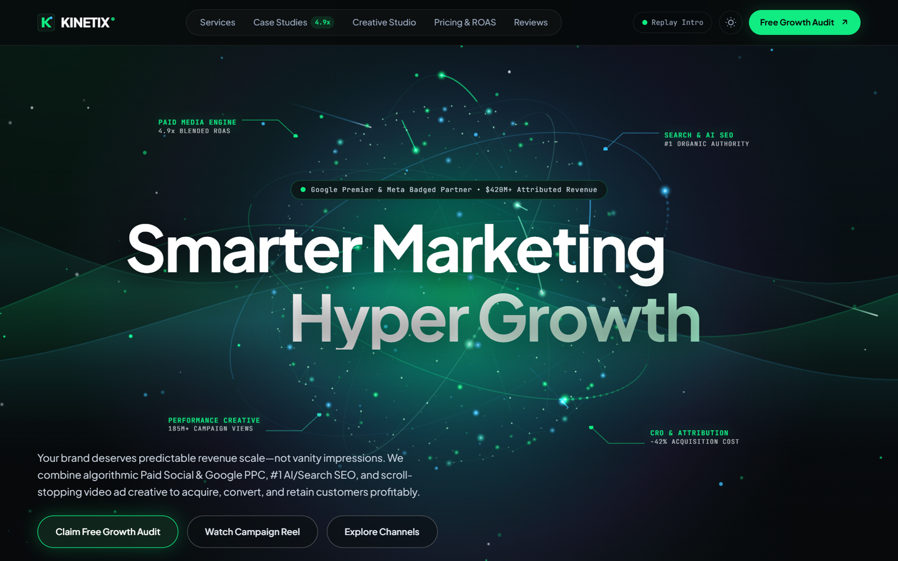
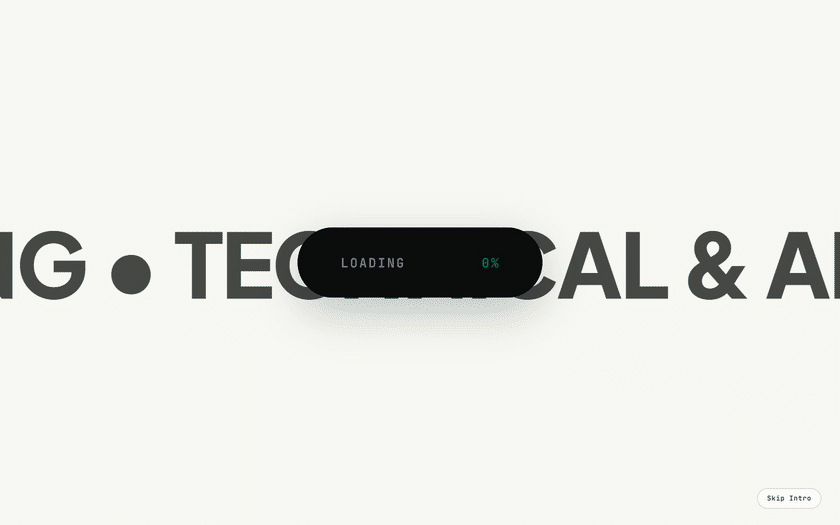
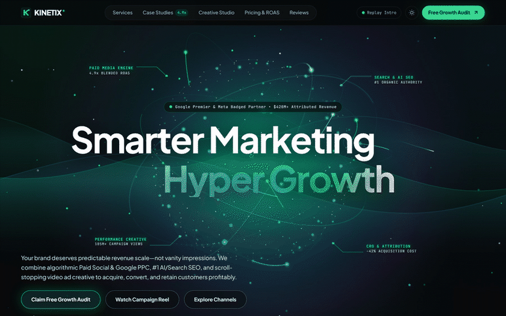
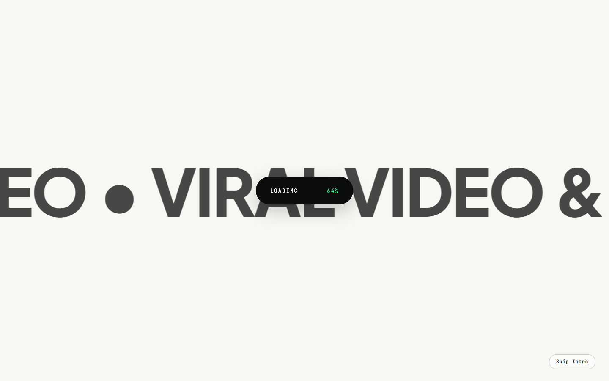
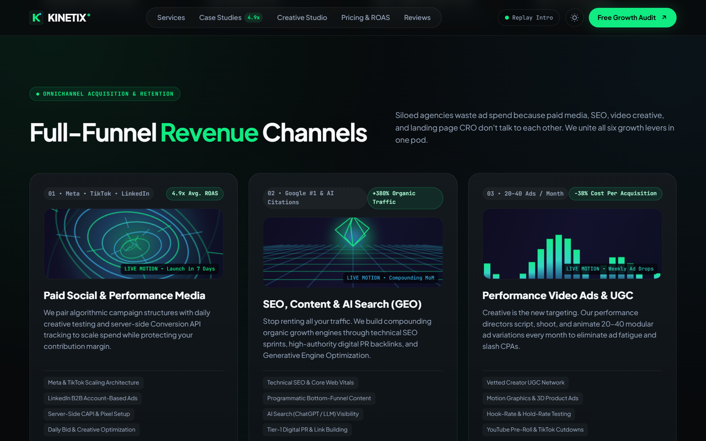
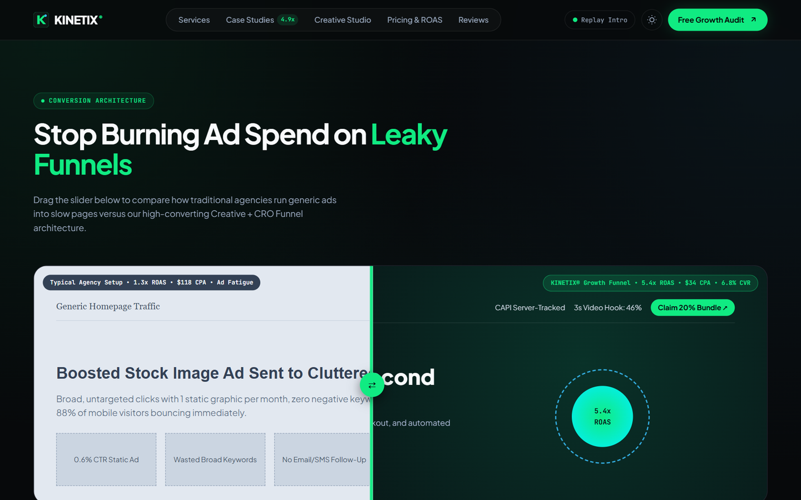
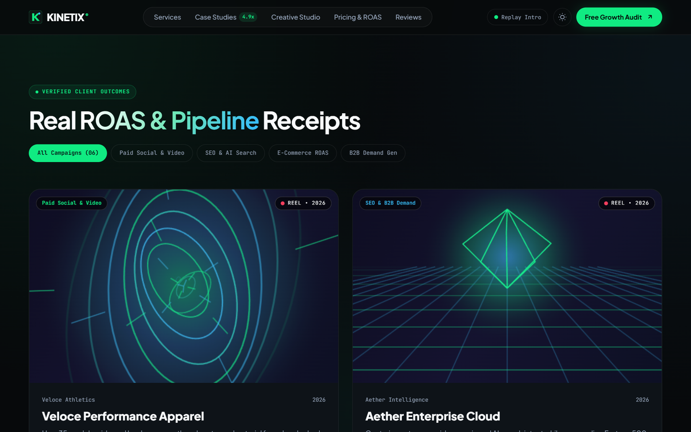
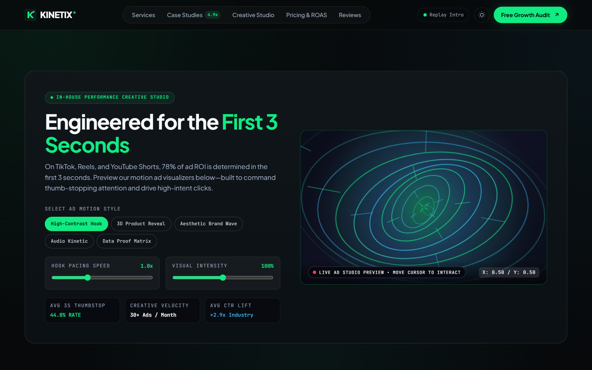
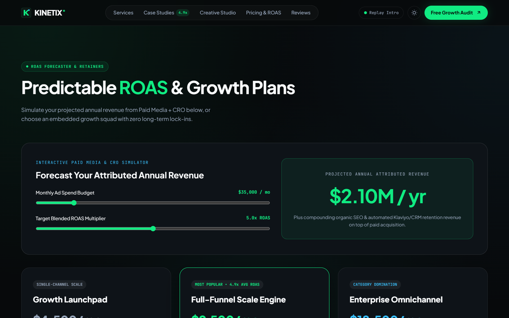

# KINETIX® Growth — Performance Digital Marketing Agency


A high-converting, mock-data-driven **Digital Marketing & Revenue Growth Agency** web experience featuring a warm editorial marquee preloader, a dual-canvas **3D Holographic Globe & Liquid Silk Aurora** hero engine, interactive CRO & ROAS calculators, and viewport-culled 60 FPS motion engineering.



---

## Motion & Video Demos

### 1. Signature Intro Preloader → Full-Screen Capsule Reveal
Warm off-white (`#F7F8F3`) scrolling channel marquee with a center black `LOADING 0% → 100%` capsule that collapses to a vertical bar (`|`) and scales into darkness to unveil the 3D Hero stage.



### 2. Interactive 3D Holographic Globe & Liquid Aurora Engine
380-node Fibonacci holographic sphere with pole-to-pole energy waves, **3 counter-rotating 3D gyro-orbits** with true front/back hemisphere occlusion, self-drawing 3D Bezier conversion laser arcs, shooting meteors, and liquid northern-light silk curtains.



<video src="./assets/hero-3d-showcase.mp4" controls autoplay loop muted playsinline width="100%"></video>

> **[▶ Open / Download HD H.264 Video (`assets/hero-3d-showcase.mp4`)](./assets/hero-3d-showcase.mp4)**

---

## Interface & Section Gallery

| Editorial Marquee Preloader | 3D Globe & Aurora Hero |
| :---: | :---: |
|  |  |

| Full-Funnel Revenue Channels | Before / After CRO Funnel Slider |
| :---: | :---: |
|  |  |

| Filterable ROAS Case Studies | 3-Second Hook Creative Studio |
| :---: | :---: |
|  |  |

### Interactive ROAS Forecaster & Transparent Growth Retainers


---

## Core Capabilities

- **Unified Executive Design System**: Carbon Obsidian (`#07090B`) surfaces paired with Signature Emerald (`#10EB82`), Glacier Cyan (`#38BDF8`), hairline architectural borders, and full Dark / Daylight theme switching.
- **Full-Funnel Digital Marketing Sections**:
  - **Omnichannel Services**: Paid Social (Meta, TikTok, LinkedIn), Google PPC & Shopping, Technical & AI Search SEO (GEO), Viral UGC & Motion Video Ads, CRO, and Email/SMS Lifecycle.
  - **Before / After Funnel Slider**: Drag comparison contrasting a leaky `1.3x` ROAS setup against a KINETIX `5.4x` ROAS landing architecture.
  - **Filterable Campaign Case Studies**: Verified client outcomes with video previews and deep-dive campaign modals.
  - **Creative Studio & ROAS Simulator**: Real-time 3-second thumb-stop hook sandbox plus an interactive monthly ad-spend revenue calculator.
  - **Growth Audit Funnel**: Multi-step scope estimator with accessible client-side validation.
- **Technical SEO & Zero-Lag 60 FPS Architecture**:
  - Semantic HTML5 landmarks, Open Graph, Twitter Card, inline SVG favicon, and `MarketingAgency` Schema.org JSON-LD structured data.
  - `ZeroLagMotionEngine` powered by `IntersectionObserver` automatically pauses off-screen `<canvas>` shaders and `<video>` streams.

---

## Project Structure

```text
agency/
├── assets/                       # Screenshots, animated GIF demos & HD MP4 showcase
│   ├── 00-preloader-intro.png
│   ├── 01-hero-3d-globe.png
│   ├── 02-services-channels.png
│   ├── 03-funnel-slider.png
│   ├── 04-case-studies.png
│   ├── 05-creative-studio.png
│   ├── 06-roas-pricing.png
│   ├── hero-3d-aurora-loop.gif
│   ├── hero-3d-showcase.mp4
│   └── intro-to-hero-demo.gif
├── index.html                    # Semantic HTML5 markup, SEO meta tags & JSON-LD
├── styles.css                    # Fluid responsive layout, design tokens & animations
├── data.js                       # Mock dataset (services, case studies, ROAS tiers, FAQs)
├── app.js                        # Preloader, 3D globe & aurora engine, calculators & modals
├── .gitignore                    # Standard OS/editor exclusions
└── README.md                     # Visual documentation & setup guide
```

---

## Local Preview

No build bundler is required. Serve the `agency` directory with any static server or open `index.html` directly:

```bash
# Using Node.js npx serve
npx serve .

# Or using Python 3
python -m http.server 8080
```
